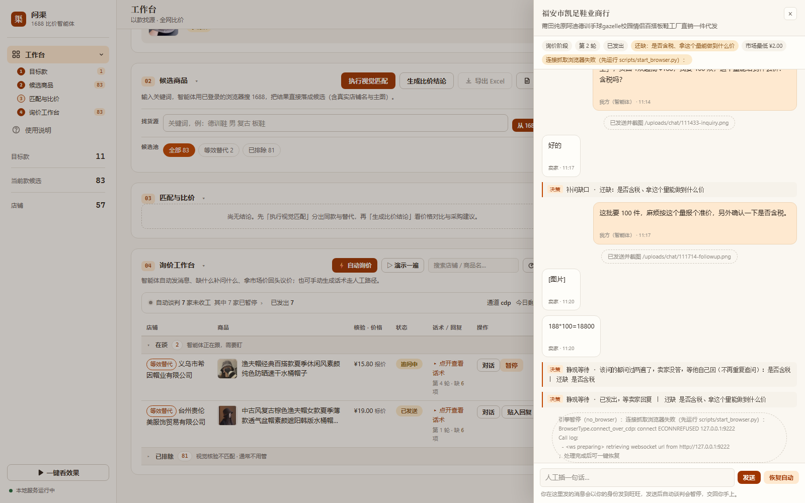

# 1688 比价智能体（问渠 Springhead）

全平台全品类的「以款找货源 + 比价」智能体（服装、数码、百货等均适用）。录入目标款（图片/文字描述），在 1688 全网召回候选店铺，AI 视觉判定同款/等效替代，逐家询价，最后给出比价结论、采购建议与议价话术。

## 界面预览

**工作台总览**——目标款卡片、候选商品管理、比价结论自动回显、右侧智能体控制台（ReAct 轨迹 + token 用量 + 跨会话对话记忆）：


**询价工作台**——按视觉核验分层与价格排序，筛选 chips 一键过滤，报价落库自动解析并核验：


**自动谈判**——点「⚡ 自动询价」，智能体在真实浏览器里发询价、缺什么补问什么、拿市场最低价回头议价；进度、缺口、暂停/接管都在列表里：


> 谈判在服务端线程里跑，关掉页面也继续。看板每 5 秒静默拉一次状态，**有变化才重绘**（不闪屏、不收你展开的话术、不动滚动位置）：变化的那行闪一下，顶栏弹一条可点开的提示；标签页在后台时降频到 10 秒，改用标题上的未读角标。所以卖家回话不用刷新页面。

**会话抽屉**——逐句可见智能体跟卖家说了什么，随时暂停交回自己手上（截图为 `mock` 通道，假卖家不会真的发到 1688）：



**比价结论**——84 家候选自动归一（标价+报价），完全同款行橙色高亮当前最低，附成交条件与议价话术：


## 演示

页面里点「▷ 演示一遍」，用剧本卖家用三分钟跑完 询价 → 补问缺口 → 议价 → 收工，不碰真实账号、不用等卖家在线。每步判断都写在会话流的「决策」行里（`补问缺口 · 还缺：是否含税、运费怎么算`），是它自己算出来的，不是事后说明。

想验证真的发出去了，点「⚡ 自动询价」——发送那一刻会截图存证，带时间戳和「已读」标记，即使卖家几小时后才回也能对得上。

> 历史录屏（2026-11-03 录制，早于自动谈判上线，只作过程记录，**不代表当前能力**）：
> [智能体自主分析](app/web/static/videos/demo-agent.mp4) —— ReAct 多轮推理与工具调用。

## 定位

- **小批量买家**：同款谁便宜，横向比价。
- **大宗进货方**：拿有条件报价，判断谈判空间，给出议价建议与话术。

## 核心流程

```
录入目标款（图/文字）
   → 候选召回：智能体经 CDP 接管浏览器按关键词自动搜索导入（主路径）/ 书签脚本抓当前页（兜底）
   → 视觉匹配为主（多模态比对；仅视觉失败或缺图时降级属性规则核验）
   → 分层：完全同款（已核验）/ 等效替代（未核验，需声明）/ 已排除
   → 自动谈判（智能体在真实浏览器里发询价 → 缺口驱动追问 → 拿市场最低价回头议价 → 报价自动入库）
   → 浏览器不可用时降级半自动询价（只生成话术，人工发送后贴回回复）
   → 比价 + 采购建议 + 议价话术 + 一键导出报告
```

## 功能特性

- **视觉同款匹配**：多模态大模型比对目标款与候选商品图；提示词品类自适应（服装/数码/鞋包/家电等各有比对维度），通用判定核心针对拍摄差异（模特/挂拍/平铺、角度、水印、供货示意图）做过调优；「看不到细节」不武断判否，只有明确矛盾才排除
- **分层可比**：完全同款（exact）才进硬比价，等效替代（equivalent）标注参考，已排除/未核验不参与硬比价
- **增量匹配**：已判定商品复用结果，只算新商品；视觉比对 8 线程并发；匹配结果带置信度与判定理由
- **CDP 自动导入**：智能体通过 Chrome DevTools Protocol 接管浏览器，自主构造 1688 搜索（含 GBK 关键词编码）、抓取搜索结果卡片、下载主图、入库建店，长任务带持久化执行计划（跨会话续跑）
- **自动谈判（会聊天的询价）**：智能体接管已登录的真实浏览器，打开店铺会话自动发出询价，然后进入「观察 → 解析 → 决策 → 再开口」的循环：每轮从卖家回复里增量抽取报价字段（价格/MOQ/含税/运费/现货/发货时效/阶梯价），**只补问还缺的那几项**，问全后拿全市场最低价做锚点回头压价，收敛即收工。全程落在会话流里，可随时暂停、人工插话接管
- **半自动询价（降级路径）**：LLM 生成带属性核验问题的询价话术，人发送后贴回卖家回复，自动解析结构化报价；LLM 失败自动降级正则；报价落库后后台自动补跑该商品的视觉核验
- **比价结论**：标价与报价归一合并（报价优先），给出综述、采购建议、议价话术（LLM 生成，规则兜底）；结论带输入数据指纹缓存，数据不变则秒出（零 LLM 调用）
- **ReAct 智能体**：DeepSeek function calling 驱动，13 个业务工具自主规划（看目标款 → 找候选 → 自动导入 → 匹配 → 比价 → 自动发起谈判 → 制定/更新长任务计划），推理轨迹与 token 用量前端可见，按目标款保留多轮对话记忆
- **一键导出**：比价表 CSV + Markdown 比价报告（结论/价格明细/询价进度/报价汇总）
- **一键启动**：`start.bat` 自动拉起/复用看板服务与抓取浏览器（端口探测、健康检查、日志落盘）
- **离线降级**：无 `DEEPSEEK_API_KEY` 时话术/报价解析/议价全部走规则兜底，链路可跑通

## 自动谈判：从「生成话术」到「替你把价谈下来」

询价真正的成本不在写话术，在「发出去 → 等回复 → 没答全 → 再追问 → 最后砍价」这一串来回。
所以这一层不是把话术自动发出去就完事，而是一个带状态机的会话循环：

```
        ┌──────── 缺口清单（价 / MOQ / 含税 / 运费 / 现货 / 时效）
        ↓
开场询价 → 读会话 → 增量解析 → 只补问缺的 → 问全了？
                                            ↓ 是
                                  拿市场最低价议价 → 收敛 / 转人工
```

四条设计原则：

1. **只问缺的**。每轮解析后算缺口，只追问还没答的项，不把问过的问题再问一遍——重复提问是最像机器人的行为。
2. **报价增量合并**。卖家习惯分三条说完（先报价、再补起订量、最后补运费），所以解析结果按「非空才覆盖」合并，不是每轮重写。
3. **议价必须有锚点**。目标价取「全市场最低报价」与「参考价」里更严格的那个，再留 1% 余量；话术里引用的别家价格来自数据库里的真实报价，不虚构。已经是最便宜的那家不浪费口舌，直接收工。
4. **发得出去的才算话术**。推理型模型偶尔会把「需要一句话，最好直接输出 msg」这种自我推敲写进正文，所以每条外发消息都过一遍质量校验（标记提取 → 净化 → 元指令检测），不过关就回退规则模板。宁可少一点文采，也不能发出去一句莫名其妙的话。
5. **要听得懂人在说什么**。卖家说「我去问下」就等，别催；卖家这轮没说话就别自说自话追问；卖家只说「含税」「1 个起批」也要当有效信息收下——同一件事问第二遍，是这个智能体最像机器人的一刻。

### 多轮实战校准（2026-11-06，真实 1688 账号）

在真实店铺上跑多轮暴露的问题，比任何离线用例都具体。全部已修，并各自留了回归用例：

| 现象 | 根因 | 处理 |
| --- | --- | --- |
| 卖家收到半句「老板，麻烦再确认」 | 模型输出被截断，长度/中文比例都过了校验 | 外发前拦「悬空尾巴」（以再确认/问下/还有/关于等收尾，限短句）→ 回退模板 |
| 模型把「用户语言中文…给两个版本…最终回复结构」整段发出去 | 元指令词表没覆盖「该怎么写这条话术」这类自我推敲 | `_META_HINTS` 补词；议价话术必须含问句、分句 ≤ 3 |
| 卖家已说「含税」，下一轮又问含税 | 解析结果只有「有价格」才入库，税/运费/现货被丢弃 | `_has_signal`：税、运费、现货、时效任一有效即合并入库 |
| 卖家说「要看你发哪个地址」= 不包邮，却被当成没提运费 | 规则只认「不含运费」这类直白说法 | 补条件式口径：「看/按/视…地址…运费」→ 运费另算 |
| 卖家回「好的 这边问下」，机器人立刻又催一遍 | 把「承诺去确认」当成「回复里没信息」 | `classify_reply` 增 `pending` 意图 → 等（≥180s），不催；「店长还没回、会留言」同样算 |
| 检查点提前、卖家还没回，又追了一遍同样的话 | 最后一句是卖家说的但没有新消息，被当成「他回了句空的」 | 无新内容 → `wait`，不重复追问 |
| 卖家在中间插了句「还没回复」，同一句追问又发一遍 | 幂等检查只看「最后一条消息」 | 改为比对**最近一条我方消息** |
| 同一条我方消息在库里出现两次 | 拿 SYSTEM 系统提示（不在页面上）去对齐，永远匹配失败 → 回退「最后 3 条」 | `_align` 只用聊天消息定位 |
| 卖家问「可以+个联系方式吗」还在继续谈价 | 站外引流词表只认「加微信」 | 补「个联系方式/加v/vx号」→ 转人工 |
| 「200 件的话 48 一个」「3 天内可以发出」「最低 47.5」全解析失败 | 规则只认带「元」的写法 | 补口语单价（N 一个/一件）、时效夹副词、让价口语 |
| LLM 解析漏了「含税」，规则明明能认出却不生效 | `parse_quote` 里 LLM 与规则是二选一，LLM 返回就跳过规则 | 改为互补：模型抽到的留着，没抽到的用规则补位 |
| 议价话术被丢弃、会话卡在「等回复」 | 残句规则误伤正常收尾（模板结尾「我再看下」） | 悬空尾巴只对 ≤14 字的短句生效 |
| 拿「1 个起批 56.9」去比别家「200 件起批 57.6」，得出「我们最便宜」 | 量级不对齐，比价结论是假的 | 卖家报拿样档（≤10 件起）且我方量 ≥100 时，必问「这个量什么价」 |
| 4 轮就收工，永远走不到议价 | 卖家习惯把信息拆成几条说，4 条额度在采集阶段就耗尽 | `max_rounds` 默认 6 |

解析规则升级后，历史对话不会自动重算，用 `scripts/reparse_quotes.py --session <id>` 按当前规则重建报价（幂等，可反复跑）。
多轮决策可以在不碰真实账号的前提下重放：`scripts/verify_multiround.py --session <id>`。

**风控是硬约束，写在调度层而不是话术层**：单次批量只发高置信度的少数店铺（默认 8 家），一家店一个款只聊一次；两次发送之间静默随机间隔，每日新建会话有配额；命中验证码或登录失效时整个引擎暂停并提示，处理完一键恢复，绝不做「多重试几次也许就过了」。

**会话状态**：`draft → sending → sent → following_up → negotiating → quoted`，异常路径 `escalated`（转人工）/ `expired`（超时关闭）。

### 两条通道

| 通道 | 说明 | 用途 |
| --- | --- | --- |
| `cdp`（默认） | Playwright 接管已登录的真实浏览器；已知旺旺号时**直连 IM 页面**，未知时打开详情页点「客服」并捕获新开的会话标签页 | 真实询价 |
| `mock` | 按剧本回复的假卖家，价格按 session 派生（各家不同价），模拟「先只报价格 → 补齐税费运费 → 让一口价」的真实节奏 | 无账号验证、演示、回归测试 |

### 真实链路（实测结构，不是推测）

```
详情页 detail.1688.com/offer/<id>.html
   └─ 点 a.action-item「客服」
        └─ 新标签页 air.1688.com/.../def_cbu_web_im/index.html?touid=<旺旺号>
             └─ iframe def_cbu_web_im_core      ← 真正的聊天面板
                  输入框 .editBox .edit[contenteditable="true"]
                  发送键 .send-btn（空内容时带 send-btn--empty）
                  消息   .message-item（我方 = 额外带 .self 类）
```

几个用真实账号跑出来的结论：

- **详情页有验证码墙，IM 页面没有**。`touid` 拿到后直连 IM，既快又避开验证码；`Shop.aliww` 就是缓存的这个号，首次自动发现后回写。
- **旺旺号不能靠规则拼**。`台州市乔纳斯塑业有限公司` 的号是 `cnalichn乔纳斯塑业`，而 `台州沃乐克家居用品有限公司` 的号是 `cnalichn台州沃乐克家居用品`——前缀保留与否不一致，只能从跳转 URL 里取。
- **换行等于发送**。输入框里按回车就是发出，所以外发文本必须先压成单行（`_one_line`），否则一段多行文本会被拆成 N 条碎片轰给卖家。
- **已发送消息也是 `<pre class="edit">`**。选择器不限定在 `.editBox` 内，就会把历史消息当成输入框内容，进而误判"没发出去"并重复发送。
- **同步 Playwright 只在执行命令时处理协议事件**。轮询等 iframe 出现必须用 `page.wait_for_timeout()`，纯 `time.sleep()` 看不到新 frame（实测卡满 25 秒仍只有 2 个 frame）。

页面结构变化时先跑校准工具，不要靠猜选择器：

```bash
python scripts/start_browser.py                                   # 启动抓取浏览器并登录 1688
python scripts/probe_chat.py https://detail.1688.com/offer/xxx.html   # 只读，探结构
python scripts/live_trial.py --product <商品id>                    # 只读，打印会话内容
python scripts/live_trial.py --product <商品id> --send "老板，这款什么价？"   # 真发一条
```

`live_trial.py` 命中滑块时会**停下来等人**（默认 10 分钟），不会尝试自动破解；过一次之后 `x5sec` cookie 留在 profile 里，后续详情页即可正常打开。

### 关键配置

| 变量 | 默认 | 说明 |
| --- | --- | --- |
| `INQUIRY_CHANNEL` | `cdp` | `cdp` 真实浏览器 / `mock` 离线剧本 |
| `INQUIRY_MIN_DELAY` | `60` | 等回复的基础间隔（秒），其余档位按 3/10/30/120 倍放大；演示可设 4 |
| `INQUIRY_MAX_ROUNDS` | `4` | 单会话我方最多发几条（1 询价 + 追问 + 1 议价） |
| `INQUIRY_DAILY_LIMIT` | `25` | 每日新建会话上限（账号安全配额） |
| `INQUIRY_SEND_INTERVAL` | `8` | 两次发送之间的静默秒数 |
| `INQUIRY_BARGAIN_MIN_GAP` | `0.03` | 与市场最低价差多少才值得开口压价 |

离线验证整条谈判链路（不需要浏览器和 1688 账号）：

```bash
python scripts/verify_negotiation.py
# 输出完整对话流、每轮的缺口与决策理由、最终成交价与相对标价的降幅
```

## 技术栈

- Python 3.11+ / FastAPI + uvicorn / Playwright（CDP 接管）
- LLM：DeepSeek（deepseek-chat 文本 / 多模态视觉，OpenAI 兼容协议，可插拔）
- 数据：SQLite（标准库 sqlite3，无 ORM），可平滑迁移 PostgreSQL
- 前端：FastAPI 返回的轻量 HTML 看板（左侧导航 + 工作台下的流程下拉 + 智能体控制台）
- 测试：pytest 170 用例（单测/端到端/视觉稳定性，慢测试标记隔离）

## 目录结构

```
app/
  models/        数据模型（Pydantic）+ 状态枚举
  store/         数据存取（SQLite，含 schema 迁移与智能体计划表）
  matcher/       匹配引擎：vision.py 视觉比对 / matcher.py 分层与复核 / image.py pHash
  inquire/       询价话术生成 + 报价解析 + 谈判决策（dialogue.py）+ 会话编排（engine.py）
  browser/       CDP 抓取（cdp.py）+ 旺旺会话执行器（chat.py，真实通道 / 离线剧本）
  comparison/    比价 + 建议 + 议价话术（带指纹缓存）
  llm/           LLM 客户端（DeepSeek 可插拔）+ token 用量统计
  agent/         ReAct 智能体（react.py 循环 / tools.py 13 工具 / service.py 组装）
  api/           FastAPI 路由（REST + 智能体 + 报告导出）
  web/           看板模板 + 书签导入页
scripts/         工具脚本（浏览器启动器、一键启动、书签 JS、种子数据等）
tests/           65 个测试（单元 / API 冒烟 / 询价闭环 / 智能体规划 / 视觉稳定性）
start.bat        Windows 一键启动
```

## 快速开始

```bash
pip install -e ".[dev]"
cp .env.example .env   # 按 .env.example 注释填 LLM_*（文字 + 视觉统一走一个 OpenAI 兼容端点）
                       # 不配任何 key 时话术/解析/议价走规则兜底，链路仍可跑通
python scripts/start_all.py     # 或 Windows 下直接双击 start.bat
```

打开 http://127.0.0.1:8000

- 首页：目标款管理、候选商品、视觉匹配、询价工作台（可搜索/按核验分层排序）、比价结论
- 书签页（兜底）：`/bookmarklet`（拿「一键导入」书签，去 1688 商品页点击即入库；从「使用说明」页进入）
- 智能体控制台：输入目标（如「帮我看看这个款哪家最便宜」），看自主推理轨迹与执行计划

## API 一览

| 方法 | 路径 | 说明 |
| --- | --- | --- |
| GET/POST | `/api/targets` | 目标款列表 / 创建 |
| POST | `/api/targets/from-url` | 书签从 URL 创建目标款 |
| POST | `/api/targets/{id}/crawl` | 按关键词搜索 1688 并批量导入候选（页面上「找货源」按钮，单次上限 40） |
| POST | `/api/import-product` | 书签导入候选商品（自动建店铺） |
| POST | `/api/targets/{id}/match` | 视觉匹配（默认增量，`?incremental=false` 强制全量） |
| GET | `/api/targets/{id}/inquiries` | 询价工作台列表（按核验分层 + 价格排序） |
| POST | `/api/inquiries/{id}/auto` | 单条发起自动谈判（发送→追问→议价→收敛） |
| POST | `/api/targets/{id}/inquiries/auto` | 批量发起（按店铺去重、默认上限 8 家、排除已排除商品） |
| GET | `/api/inquiry-engine` | 引擎状态：未收工会话数、其中暂停数、今日配额、风控阻断原因 |
| POST | `/api/inquiry-engine/run` | 立即推进一轮（演示/调试用，不等定时 tick） |
| POST | `/api/inquiry-engine/resume` | 人工处理完验证码/登录后恢复被暂停的会话 |
| GET | `/api/sessions` | 在谈会话名单（店名/状态/轮次/最后一句，页面上点状态条展开） |
| GET | `/api/sessions/{id}` | 会话详情 + 完整消息流（对话抽屉数据源） |
| POST | `/api/sessions/{id}/pause` | 暂停/恢复单个会话 |
| POST | `/api/sessions/{id}/inject` | 人工插话（走同一通道，发送后自动暂停自动谈判） |
| POST | `/api/inquiries/{id}/parse-reply` | 解析卖家回复 → 报价 → 后台自动核验（人工路径） |
| GET | `/api/targets/{id}/quotes` | 报价列表 |
| POST | `/api/targets/{id}/comparison` | 生成比价结论（指纹缓存） |
| GET | `/api/targets/{id}/report` | 生成 Markdown 比价报告 |
| POST | `/api/agent/run` | ReAct 智能体执行任务（返回推理轨迹/计划/token） |
| GET | `/api/agent/plan` | 当前目标款进行中的长任务计划 |

## 测试

```bash
pip install -e ".[dev]"
python -m pytest -m "not slow"   # 快测（单测 + 冒烟，约 3 秒，无网络）
python -m pytest                 # 全量（含视觉慢测试，需 DEEPSEEK_API_KEY）
```

| 文件 | 覆盖 |
| --- | --- |
| `tests/test_unit.py` | 比价合并（多报价最新生效）、匹配分层、报价正则兜底、视觉提示词品类自适应 |
| `tests/test_api_smoke.py` | 看板全部端点、目标款增删闭环 |
| `tests/test_inquiry_e2e.py` | 询价闭环：话术 → 解析报价 → 比价纳入 |
| `tests/test_agent_plan_tools.py` | 长任务计划持久化/替换/续跑、增量匹配复用、图片路径解析 |
| `tests/test_auto_import.py` | CDP 自动导入：抓取解析 → 建店 → 图片落盘 → 入库 |
| `tests/test_agent_e2e.py` | 智能体自主决策：工具调用轨迹 + 结论具体性 |
| `tests/test_dialogue.py` | 谈判决策：缺口计算、增量合并、追问/议价/收手分支、模型输出净化 |
| `tests/test_vision_retest.py` | 视觉判定稳定性 + 跨品类负对照（slow 标记） |

测试跑在真实库的临时副本上（`tests/conftest.py` 自动隔离），不会改动本地数据。
视觉模型对个别边界商品有判定抖动，稳定性断言容忍至多 1 个「同款→不同」翻转、一致率 ≥70%，
用于拦截系统性回归而非要求逐位一致。

## 已知限制

- **到手价未完全归一**：阶梯价与 MOQ 门槛已按 100 件基准量折算「归一价」并参与排序（原始价保留展示）；含税 / 运费仍仅作展示未折算进单价。页面标价可能是引流价，最低价若来自标价，结论中会显式提示「以已核实报价为准」
- **数据为时点快照**：标价/库存/发货时效在导入与询价时采集，不会自动刷新；比价表每行标注数据时间（7 天内常态 / 7~30 天标黄 / 30 天以上标灰），报告含「数据截至」行，超期可用「重算结论」重新生成（重抓价格仍需书签/导入）
- **阶梯价解析有限**：LLM 解析失败降级正则时，仅识别「满 N 件 M 元 / N 件以上 M 元」两种常见写法
- **单图比对**：视觉判定只用商品首图，多色合集图可能影响判定
- **视觉判定噪声**：边界商品的分层存在模型固有抖动（灰区已自动二次复核），且判定倾向召回优先；人工纠正反馈回路见后续方向
- **自动谈判依赖页面结构**：发送/读取都靠 DOM 选择器，1688 改版会失效；失效时引擎转人工而不是硬闯，改版后用 `scripts/probe_chat.py` 重新校准即可。买家侧没有公开的旺旺消息 API，浏览器接管是当前唯一可行路径
- **详情页会有验证码墙**：这个 profile 直接访问详情页会被跳到滑块验证，需人工过一次（`live_trial.py` 会停下来等）。过一次后 `x5sec` cookie 留在 profile 内，且拿到 `touid` 后可走 IM 直连彻底绕开详情页
- **自动谈判有账号风险**：自动化操作可能触发风控（验证码、限权）。已做限额、限速、话术差异化、单店单会话，但无法消除风险；建议先用小块候选验证，确认可用再放开
- **外发文本强校验**：模型输出必须通过「单行、非 Markdown、非分析口吻」校验，否则退回规则模板。宁可少点文采，也不能把推理过程发到卖家那里（真实踩过：一段 Markdown 被拆成 5 条碎片发出去）
- **纯文字对话**：卖家发图片报价单时无法读取（图片消息只在会话流里标记，需人工查看）
- **详情页已有的信息仍会重复问**：店铺详情页常直接写明价格区间、起批量、运费、库存、发货时效，但当前决策层只依赖对话内容，仍会把这些当"缺口"去问。下一步应当用详情页数据预填会话缺口（这能省掉一整轮追问）
- **CDP 自动导入依赖本地登录态**：1688 风控变化可能导致启发式提取失效，导入结果为空时建议改用书签导入
- **单用户**：SQLite 单库无鉴权，仅适合个人使用

## 免责声明

本项目仅供个人学习与研究。数据抓取与浏览器自动化部分仅针对公开页面、小规模手动触发，
请遵守目标网站的robots协议与服务条款，勿用于任何商业用途。仓库不包含任何抓取数据、
数据库文件与账号登录态（见 `.gitignore`）。

## 后续方向

- 含税 / 运费折算进到手价（ MOQ / 阶梯价已归一）
- PostgreSQL 迁移与多用户
- 匹配判定的人工纠正反馈回路
- 卖家发来的图片报价单走视觉识别（当前只标记不解析）
- 议价策略学习：按历史成交价与卖家历史让价幅度调整开口力度
