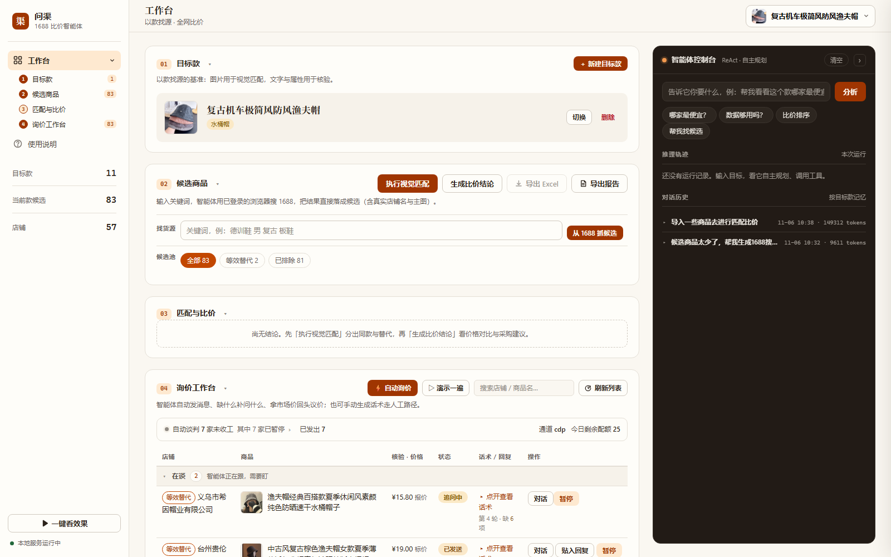
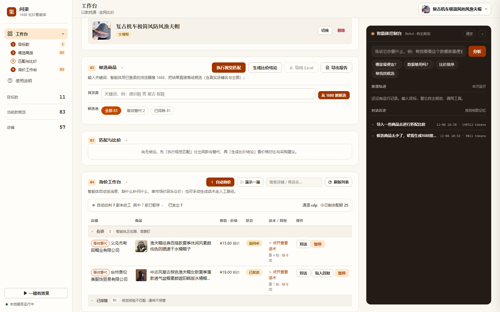
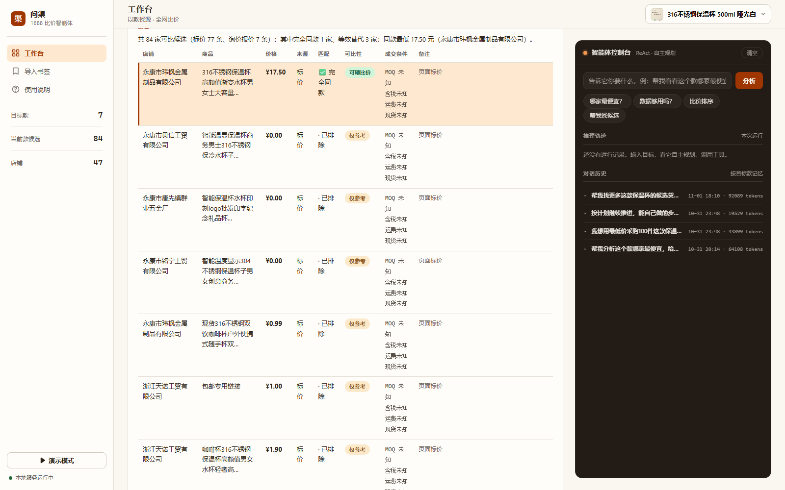

# 1688 比价智能体（问渠 Springhead）

全平台全品类的「以款找货源 + 比价」智能体（服装、数码、百货等均适用）。录入目标款（图片/文字描述），在 1688 全网召回候选店铺，AI 视觉判定同款/等效替代，逐家询价，最后给出比价结论、采购建议与议价话术。

## 界面预览

**工作台总览**——目标款卡片、候选商品管理、比价结论自动回显、右侧智能体控制台（ReAct 轨迹 + token 用量 + 跨会话对话记忆）：



**询价工作台**——按视觉核验分层与价格排序，筛选 chips 一键过滤，报价落库自动解析并核验：



**比价结论**——84 家候选自动归一（标价+报价），完全同款行橙色高亮当前最低，附成交条件与议价话术：



## 演示视频

**方式一 · 智能体自动分析**——一句话目标，ReAct 智能体自主调工具，推理轨迹实时可见：

[▶ 观看视频（点击在线播放）](app/web/static/videos/demo-agent.mp4)

**方式二 · 书签手动导入**——1688 搜索页一键书签批量导入候选 → 视觉匹配 → 比价结论：

[▶ 观看视频（点击在线播放）](app/web/static/videos/demo-manual.mp4)

**进阶 · 询价闭环**——复制话术问价 → 回贴卖家回复 → 自动解析价格/MOQ/含税/现货/发货时效/阶梯价 → 比价结论纳入真实报价：

[▶ 观看视频（点击在线播放）](app/web/static/videos/demo-inquiry.mp4)

> 视频为 Playwright 真实录屏（录制脚本 `scripts/record_demo.py`、`scripts/record_inquiry.py` 可复现）；本地克隆后页面内嵌播放器见 `使用说明` 页。

## 定位

- **小批量买家**：同款谁便宜，横向比价。
- **大宗进货方**：拿有条件报价，判断谈判空间，给出议价建议与话术。

## 核心流程

```
录入目标款（图/文字）
   → 候选召回：书签脚本从 1688 商品页一键导入 / 智能体经 CDP 接管浏览器自动搜索导入
   → 视觉匹配为主（多模态比对；仅视觉失败或缺图时降级属性规则核验）
   → 分层：完全同款（已核验）/ 等效替代（未核验，需声明）/ 已排除
   → 半自动询价（智能体出话术 → 人发送 → 贴回复自动解析报价 → 后台自动核验）
   → 比价 + 采购建议 + 议价话术 + 一键导出报告
```

## 功能特性

- **视觉同款匹配**：多模态大模型比对目标款与候选商品图；提示词品类自适应（服装/数码/鞋包/家电等各有比对维度），通用判定核心针对拍摄差异（模特/挂拍/平铺、角度、水印、供货示意图）做过调优；「看不到细节」不武断判否，只有明确矛盾才排除
- **分层可比**：完全同款（exact）才进硬比价，等效替代（equivalent）标注参考，已排除/未核验不参与硬比价
- **增量匹配**：已判定商品复用结果，只算新商品；视觉比对 8 线程并发；匹配结果带置信度与判定理由
- **CDP 自动导入**：智能体通过 Chrome DevTools Protocol 接管浏览器，自主构造 1688 搜索（含 GBK 关键词编码）、抓取搜索结果卡片、下载主图、入库建店，长任务带持久化执行计划（跨会话续跑）
- **半自动询价**：LLM 生成带属性核验问题的询价话术，人发送后贴回卖家回复，自动解析结构化报价（价格/MOQ/含税/现货/时效/阶梯价），LLM 失败自动降级正则；报价落库后后台自动补跑该商品的视觉核验
- **比价结论**：标价与报价归一合并（报价优先），给出综述、采购建议、议价话术（LLM 生成，规则兜底）；结论带输入数据指纹缓存，数据不变则秒出（零 LLM 调用）
- **ReAct 智能体**：DeepSeek function calling 驱动，12 个业务工具自主规划（看目标款 → 找候选 → 自动导入 → 匹配 → 比价 → 出话术 → 制定/更新长任务计划），推理轨迹与 token 用量前端可见，按目标款保留多轮对话记忆
- **一键导出**：比价表 CSV + Markdown 比价报告（结论/价格明细/询价进度/报价汇总）
- **一键启动**：`start.bat` 自动拉起/复用看板服务与抓取浏览器（端口探测、健康检查、日志落盘）
- **离线降级**：无 `DEEPSEEK_API_KEY` 时话术/报价解析/议价全部走规则兜底，链路可跑通

## 技术栈

- Python 3.11+ / FastAPI + uvicorn / Playwright（CDP 接管）
- LLM：DeepSeek（deepseek-chat 文本 / 多模态视觉，OpenAI 兼容协议，可插拔）
- 数据：SQLite（标准库 sqlite3，无 ORM），可平滑迁移 PostgreSQL
- 前端：FastAPI 返回的轻量 HTML 看板（左侧导航 + 五步流程条 + 智能体控制台）
- 测试：pytest 70+ 用例（单测/端到端/视觉稳定性，慢测试标记隔离）

## 目录结构

```
app/
  models/        数据模型（Pydantic）+ 状态枚举
  store/         数据存取（SQLite，含 schema 迁移与智能体计划表）
  matcher/       匹配引擎：vision.py 视觉比对 / matcher.py 分层与复核 / image.py pHash
  inquire/       询价话术生成 + 报价解析（LLM 优先，正则兜底）
  comparison/    比价 + 建议 + 议价话术（带指纹缓存）
  llm/           LLM 客户端（DeepSeek 可插拔）+ token 用量统计
  agent/         ReAct 智能体（react.py 循环 / tools.py 12 工具 / service.py 组装）
  api/           FastAPI 路由（REST + 智能体 + 报告导出）
  web/           看板模板 + 书签导入页
scripts/         工具脚本（浏览器启动器、一键启动、书签 JS、种子数据等）
tests/           65 个测试（单元 / API 冒烟 / 询价闭环 / 智能体规划 / 视觉稳定性）
start.bat        Windows 一键启动
```

## 快速开始

```bash
pip install -e ".[dev]"
cp .env.example .env   # 按 .env.example 注释填 LLM_*（文字智能体，任意 OpenAI 兼容厂商）
                       # 与 DEEPSEEK_API_KEY（视觉匹配用多模态模型；不配则走规则兜底）
python scripts/start_all.py     # 或 Windows 下直接双击 start.bat
```

打开 http://127.0.0.1:8000

- 首页：目标款管理、候选商品、视觉匹配、询价工作台（可搜索/按核验分层排序）、比价结论
- 书签页：`/bookmarklet`（拿「一键导入」书签，去 1688 商品页点击即入库）
- 智能体控制台：输入目标（如「帮我看看这个款哪家最便宜」），看自主推理轨迹与执行计划

## API 一览

| 方法 | 路径 | 说明 |
| --- | --- | --- |
| GET/POST | `/api/targets` | 目标款列表 / 创建 |
| POST | `/api/targets/from-url` | 书签从 URL 创建目标款 |
| POST | `/api/import-product` | 书签导入候选商品（自动建店铺） |
| POST | `/api/targets/{id}/match` | 视觉匹配（默认增量，`?incremental=false` 强制全量） |
| GET | `/api/targets/{id}/inquiries` | 询价工作台列表（按核验分层 + 价格排序） |
| POST | `/api/inquiries/{id}/parse-reply` | 解析卖家回复 → 报价 → 后台自动核验 |
| GET | `/api/targets/{id}/quotes` | 报价列表 |
| POST | `/api/targets/{id}/comparison` | 生成比价结论（指纹缓存） |
| GET | `/api/targets/{id}/report` | 生成 Markdown 比价报告 |
| POST | `/api/agent/run` | ReAct 智能体执行任务（返回推理轨迹/计划/token） |
| GET | `/api/agent/plan` | 当前目标款进行中的长任务计划 |

## 测试

```bash
pip install -e ".[dev]"
python -m pytest -m "not slow"   # 快测（单测 + 冒烟，约 3 秒，无网络）
python -m pytest                 # 全量（含视觉慢测试，需 DEEPSEEK_API_KEY）
```

| 文件 | 覆盖 |
| --- | --- |
| `tests/test_unit.py` | 比价合并（多报价最新生效）、匹配分层、报价正则兜底、视觉提示词品类自适应 |
| `tests/test_api_smoke.py` | 看板全部端点、目标款增删闭环 |
| `tests/test_inquiry_e2e.py` | 询价闭环：话术 → 解析报价 → 比价纳入 |
| `tests/test_agent_plan_tools.py` | 长任务计划持久化/替换/续跑、增量匹配复用、图片路径解析 |
| `tests/test_auto_import.py` | CDP 自动导入：抓取解析 → 建店 → 图片落盘 → 入库 |
| `tests/test_agent_e2e.py` | 智能体自主决策：工具调用轨迹 + 结论具体性 |
| `tests/test_vision_retest.py` | 视觉判定稳定性 + 跨品类负对照（slow 标记） |

测试跑在真实库的临时副本上（`tests/conftest.py` 自动隔离），不会改动本地数据。
视觉模型对个别边界商品有判定抖动，稳定性断言容忍至多 1 个「同款→不同」翻转、一致率 ≥70%，
用于拦截系统性回归而非要求逐位一致。

## 已知限制

- **到手价未完全归一**：阶梯价与 MOQ 门槛已按 100 件基准量折算「归一价」并参与排序（原始价保留展示）；含税 / 运费仍仅作展示未折算进单价。页面标价可能是引流价，最低价若来自标价，结论中会显式提示「以已核实报价为准」
- **数据为时点快照**：标价/库存/发货时效在导入与询价时采集，不会自动刷新；比价表每行标注数据时间（7 天内常态 / 7~30 天标黄 / 30 天以上标灰），报告含「数据截至」行，超期可用「重算结论」重新生成（重抓价格仍需书签/导入）
- **阶梯价解析有限**：LLM 解析失败降级正则时，仅识别「满 N 件 M 元 / N 件以上 M 元」两种常见写法
- **单图比对**：视觉判定只用商品首图，多色合集图可能影响判定
- **视觉判定噪声**：边界商品的分层存在模型固有抖动（灰区已自动二次复核），且判定倾向召回优先；人工纠正反馈回路见后续方向
- **询价半自动**：话术人发、回复人贴（自动发送依赖旺旺协议，未实现）
- **CDP 自动导入依赖本地登录态**：1688 风控变化可能导致启发式提取失效，导入结果为空时建议改用书签导入
- **单用户**：SQLite 单库无鉴权，仅适合个人使用

## 免责声明

本项目仅供个人学习与研究。数据抓取与浏览器自动化部分仅针对公开页面、小规模手动触发，
请遵守目标网站的robots协议与服务条款，勿用于任何商业用途。仓库不包含任何抓取数据、
数据库文件与账号登录态（见 `.gitignore`）。

## 后续方向

- 含税 / 运费折算进到手价（ MOQ / 阶梯价已归一）
- PostgreSQL 迁移与多用户
- 匹配判定的人工纠正反馈回路
- 询价消息自动发送（旺旺协议研究）
